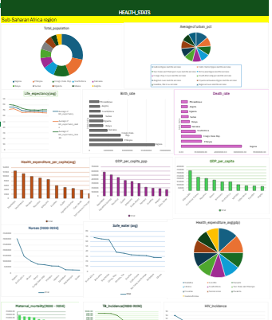

# Sub-Saharan Africa Health Indicators Analysis (2000–2024)

## Project Overview

This project analyses health and development indicators across Sub-Saharan Africa from 2000 to 2024 using Microsoft Excel. The goal is to explore differences between countries, identify patterns in health outcomes, and present findings that can support data-driven decision-making.

## Dashboard Preview

## Tools and Techniques

- Microsoft Excel
- PivotTables for summarising and comparing data
- Charts and data visualisation
- Dashboard development
- Exploratory data analysis
- Business reporting and interpretation of findings

## Key Indicators Analysed

The analysis covers indicators including:

- Life expectancy
- Poverty
- Undernourishment
- Immunisation coverage
- Health expenditure as a percentage of GDP
- Communicable and non-communicable disease deaths
- Tuberculosis and HIV incidence
- Access to safe drinking water
- Smoking prevalence

## Key Findings

The analysis highlighted differences across countries:

- **Life expectancy:** Seychelles, Cabo Verde, and Mauritius recorded high average life expectancy values in the analysis.
- **Poverty:** The Democratic Republic of the Congo, Mozambique, and Burundi appeared among the countries with high average poverty values.
- **Undernourishment:** Somalia, Zambia, and Liberia recorded high average values for this indicator.
- **Immunisation:** Seychelles recorded high values across the measles, polio, and DPT indicators.
- **Health expenditure:** Namibia and Lesotho were among the countries with higher average health expenditure as a percentage of GDP.
- **Disease burden:** The analysis showed differences between countries in the reported shares of communicable and non-communicable disease deaths.

These findings describe patterns in the analysed dataset and do not, by themselves, establish the causes of differences between countries.

## Project Deliverables

- Excel analysis using PivotTables
- Health indicators charts and dashboard
- Business report summarising findings and data limitations

## Data Considerations

The dataset covers multiple years, from 2000 to 2024. Aggregated values must be interpreted according to the indicator and calculation used. Summed values across multiple years should not be treated as current-year figures. Indicator units, definitions, and aggregation methods should be verified before drawing conclusions.

## Skills Demonstrated

- Data exploration and analysis
- Summarising data using PivotTables
- Comparing indicators across countries
- Data visualisation and dashboard creation
- Interpreting findings
- Business reporting and communication
- Identifying data limitations

## Conclusion

This project demonstrates how Microsoft Excel can be used to explore health and development data, compare indicators across countries, and communicate findings through visualisations and business reporting. It forms part of my data analytics portfolio and demonstrates my ability to turn data into meaningful insights while recognising analytical limitations.
